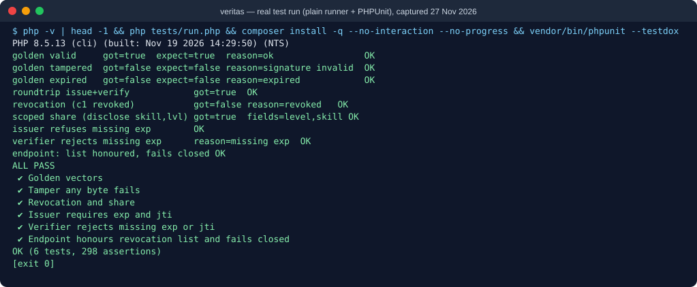

# Veritas — verifiable skill credentials — manual

*One page, eight blocks. Every figure here comes from this repository's own tests and README.*

## 1. Claim
A credential verifies offline from the issuer's public key alone, and changing a single byte makes verification fail. The same vectors verify byte-for-byte in Python, Kotlin and Swift.

## 2. What it is
Veritas issues skill credentials that carry their own proof. Anyone can check one without contacting a database. Holders can share only chosen fields, for a limited time, and issuers can revoke by id.

## 3. Demo
Tamper demo in the browser: serve `public/` and open it, then **Load sample → Verify** (passes) **→ Tamper one byte → Verify** (fails). Screenshot: `docs/screenshot.png`.


*Real output from this repository's own tests, captured 21 Nov 2026.*

## 4. Run it yourself
**Prerequisites:** PHP with ext-sodium. Composer for the full suite.

```bash
php tests/run.php
composer install && composer test
php -S localhost:8000 -t public
```

## 5. What you will see
The golden vectors pass (valid accepted; tampered and expired rejected), along with issue-to-verify round-trip, revocation and scoped-share tests.

## 6. 30-second talking point
> "The database says they passed" is not something an employer can verify. A Veritas credential is a signed token: anyone with the issuer's public key can confirm it offline. The revocation logic is also machine-checked separately, in veritas-tla.

## 7. Scope and limits
- Revocation uses a published list. Very large scale would add sharding or caching.
- Key custody is the operator's responsibility. The issuer seed never ships.

## 8. Links
[Repository](https://github.com/fhionnghaile/veritas) · [README](README.md)
